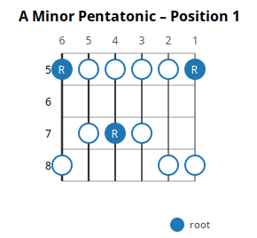
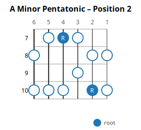
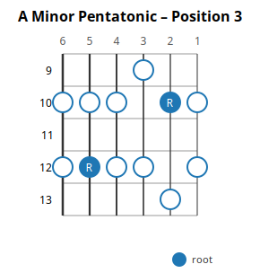
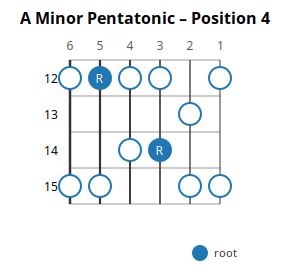
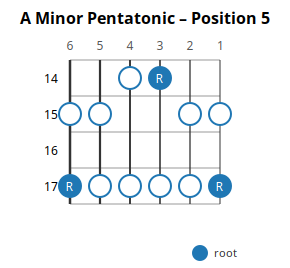

# Using the A Minor Pentatonic Scale Across All Five Positions

**Level:** intermediate  
**Estimated time:** 20 minutes  
**Key:** A minor  
**Position convention:** 5-position

## Objectives

- Identify the five notes of the minor pentatonic scale in any key
- Play all five positions cleanly at a moderate tempo
- Transition between adjacent positions without pausing
- Improvise using the scale in a musical context

## Prerequisites

- Comfortable with alternate picking
- Can play a one-octave major scale
- Knows the note names on the low E string up to the 12th fret

## Sections

### What the minor pentatonic scale is

The A minor pentatonic scale uses five notes derived from the A natural minor scale, omitting the 2nd and 6th degrees. This produces a stable, blues-friendly sound with no semitone clashes between adjacent scale tones. In A minor the five notes are A / C / D / E / G, corresponding to the intervals root (1), minor third (b3), perfect fourth (4), perfect fifth (5), and minor seventh (b7). On the fretboard it is usually taught as five overlapping positions; learning to move between them smoothly is the foundation for improvising solos.

Diagrams: `diagram-a-min-pent-pos-1`

### Position 1: A minor pentatonic, frets 5-8

Position 1 covers frets 5 through 8 and contains every note of the scale in a compact span. Play it ascending and descending, using one finger per fret where possible, and keep your thumb behind the neck. Once you can play it cleanly at a moderate tempo, connect it to position 2 by shifting to the nearest shared note on the same string rather than jumping.

Diagrams: `diagram-a-min-pent-pos-1`

### Position 2: A minor pentatonic, frets 7-10

Position 2 covers frets 7 through 10 and contains every note of the scale in a compact span. Play it ascending and descending, using one finger per fret where possible, and keep your thumb behind the neck. Once you can play it cleanly at a moderate tempo, connect it to position 3 by shifting to the nearest shared note on the same string rather than jumping.

Diagrams: `diagram-a-min-pent-pos-2`

### Position 3: A minor pentatonic, frets 9-13

Position 3 covers frets 9 through 13 and contains every note of the scale in a compact span. Play it ascending and descending, using one finger per fret where possible, and keep your thumb behind the neck. Once you can play it cleanly at a moderate tempo, connect it to position 4 by shifting to the nearest shared note on the same string rather than jumping.

Diagrams: `diagram-a-min-pent-pos-3`

### Position 4: A minor pentatonic, frets 12-15

Position 4 covers frets 12 through 15 and contains every note of the scale in a compact span. Play it ascending and descending, using one finger per fret where possible, and keep your thumb behind the neck. Once you can play it cleanly at a moderate tempo, connect it to position 5 by shifting to the nearest shared note on the same string rather than jumping.

Diagrams: `diagram-a-min-pent-pos-4`

### Position 5: A minor pentatonic, frets 14-17

Position 5 covers frets 14 through 17 and contains every note of the scale in a compact span. Play it ascending and descending, using one finger per fret where possible, and keep your thumb behind the neck. Once you can play it cleanly at a moderate tempo, return toward position 4 through the shared high-E note at fret 15 (play frets 17, 15, 12 descending).

Diagrams: `diagram-a-min-pent-pos-5`

## Practice Steps

### Step 1: Memorize position 1 shape and play it cleanly

**Action:** Play the A minor pentatonic position 1 (frets 5-8) up and down at 60 BPM, one note per click, using alternate picking. Start on the root on the low E string (string 6, fret 5), ascend the full box to fret 8 on the high E string, then descend back to fret 5 on string 6. Add a slight accent on each marked root note (blue circles with R).

**Duration:** 3 min (bpm=60, reps=4)
**Success criterion:** You can ascend to fret 8 and descend back to fret 5 twice in a row without stopping or missing a note.

Diagrams: diagram-a-min-pent-pos-1

### Step 2: Move smoothly between positions 1 and 2

**Action:** On string 1 (high E), play eight quarter notes in two bars of 4/4: frets 5, 8, 10, 8 | 8, 10, 8, 5. Fret 8 is shared by positions 1 and 2; fret 10 enters position 2, and the final fret 5 returns to A.

**Duration:** 4 min (bpm=60, reps=6)
**Success criterion:** You can play the full two-bar phrase without stopping and end cleanly on fret 5 (the root A).

Diagrams: diagram-a-min-pent-pos-1, diagram-a-min-pent-pos-2

### Step 3: Connect all five positions along one string

**Action:** Start on the root of position 1 on string 6 (fret 5) and play the pentatonic notes ascending along string 6 through position 5, then reverse and descend: frets 5, 8, 10, 12, 15, 17, 15, 12, 10, 8, 5 — one note per click, no stopping. This connects all five boxes along one string; do not attempt to jump back from position 5 to position 1 — they sit an octave apart.

**Duration:** 5 min (bpm=50, reps=3)
**Success criterion:** One unbroken ascending and descending pass through all five positions along string 6.

Diagrams: diagram-a-min-pent-pos-1, diagram-a-min-pent-pos-2, diagram-a-min-pent-pos-3, diagram-a-min-pent-pos-4, diagram-a-min-pent-pos-5

### Step 4: Improvise using only position 1

**Action:** Over an A minor backing track, improvise for two minutes using only position 1. Emphasize the root and the minor third. Rest for the same amount of time between takes.

**Duration:** 4 min
**Success criterion:** You can improvise for the full two minutes without playing outside the scale.

Diagrams: diagram-a-min-pent-pos-1

### Step 5: Use all five positions melodically

**Action:** Improvise over the same backing track, but now deliberately move between positions every four bars. Target the root note in each new position as your landing note.

**Duration:** 4 min
**Success criterion:** You land on the root in at least three different positions across the take.

Diagrams: diagram-a-min-pent-pos-1, diagram-a-min-pent-pos-2, diagram-a-min-pent-pos-3, diagram-a-min-pent-pos-4, diagram-a-min-pent-pos-5

## Tips

- Think of the five positions as one connected shape on the fretboard, not five separate patterns — every position shares notes with its neighbours.
- Anchor your hand with your index finger at the low end of each position; this keeps your other three fingers free for the higher frets.
- Practice positions in reverse order (5 back to 1) occasionally — most players over-rely on positions 1 and 2.
- Sing the root note before you start improvising so your ear has a target, not just your fingers.

## Related Topics

- [The Blues Scale (adding the b5)](../topics/blues-scale.md) — One extra note turns minor pentatonic into the blues scale; natural next step.
- [Major Pentatonic Scale](../topics/major-pentatonic.md) — A minor pentatonic and C major pentatonic share the same notes and fret locations; only the tonal center changes from A to C.
- [String Bending Basics](../topics/string-bending.md) — Bends from the 4 to the 5 are the classic pentatonic move.
- [Relative Major and Minor](../topics/relative-major-minor.md) — Explains why A minor pentatonic and C major pentatonic share a shape.
- [Improvisation Basics](../topics/improvisation-basics.md) — Practical guidance for building melodic solos from these shapes.

## Diagrams

### A Minor Pentatonic – Position 1

(`diagram-a-min-pent-pos-1`, frets 5-8)

### A Minor Pentatonic – Position 2

(`diagram-a-min-pent-pos-2`, frets 7-10)

### A Minor Pentatonic – Position 3

(`diagram-a-min-pent-pos-3`, frets 9-13)

### A Minor Pentatonic – Position 4

(`diagram-a-min-pent-pos-4`, frets 12-15)

### A Minor Pentatonic – Position 5

(`diagram-a-min-pent-pos-5`, frets 14-17)
